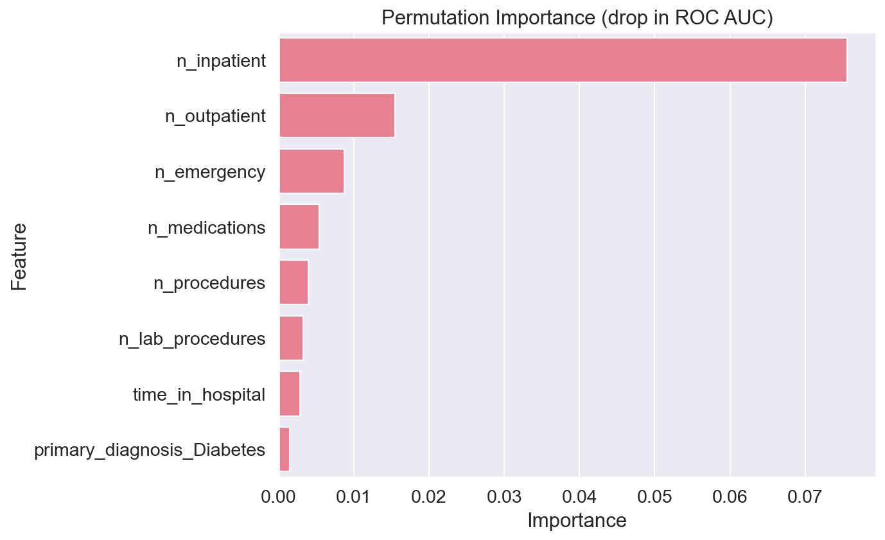
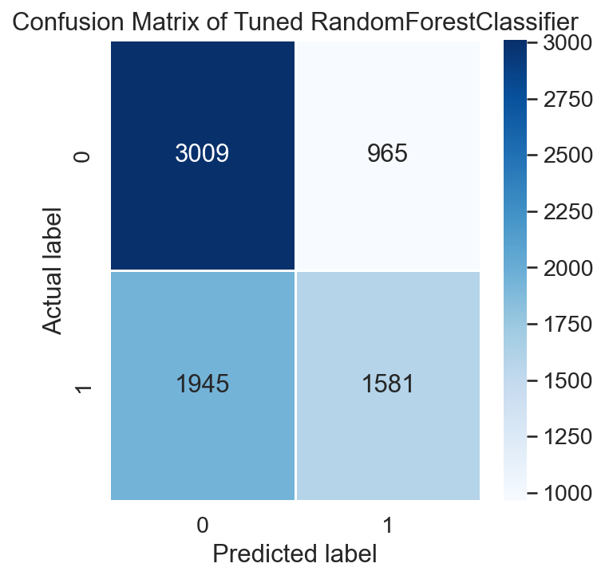
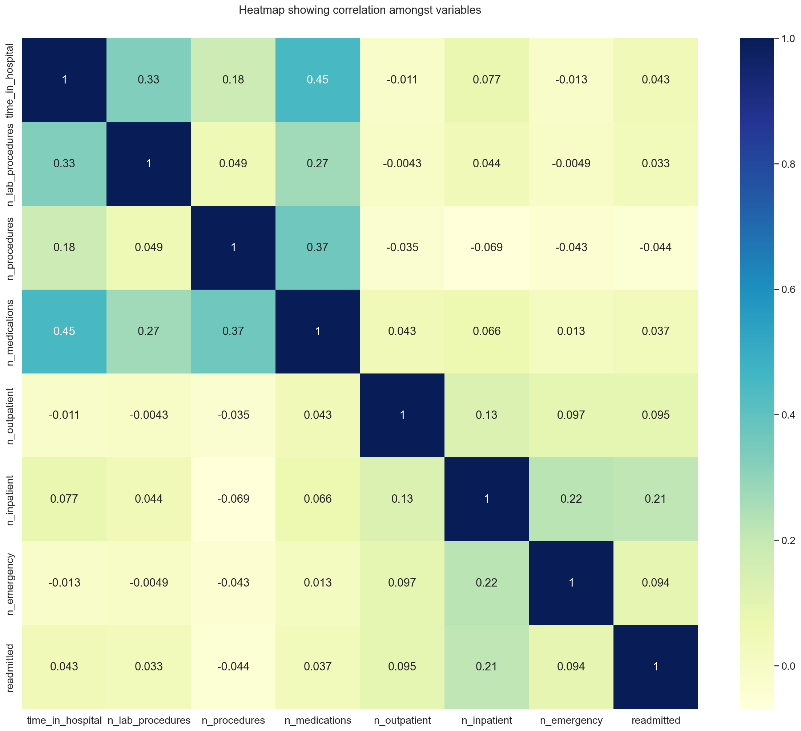

# 🏥 Hospital Readmission Prediction with Random Forest (Python Project)

## 📌 Project Overview

This project uses Python and machine learning to predict which hospital patients will be readmitted. Readmissions are a major challenge in healthcare: they affect patient outcomes, drive up costs, and are a key quality measure for hospitals.

The dataset covers 25,000 hospital stays, with patient age, length of stay, procedures, medications, prior visits, diagnoses, diabetes testing, and readmission status. About **47% of patients were readmitted**.

I trained Decision Tree, Random Forest, and Logistic Regression models, then tuned the Random Forest with a grid search. The project then went further than accuracy. I compared every model against a one-question clinical rule, measured how readmission risk rises with prior hospital use, tuned the decision threshold for a care-team use case, and checked which features truly drive predictions. The main finding: **a simple rule based on prior inpatient visits performed almost as well as the best machine learning model.**

## 🎯 Key Features

✅ Data Cleaning: Renamed columns, grouped age ranges into categories, and set the correct data types. 
✅ Exploratory Analysis: Explored diagnoses by age group and compared readmission for patients with and without diabetes. 
✅ Feature Encoding: Converted 8 categorical columns into 47 model features with one-hot encoding. 
✅ Model Training: Trained Decision Tree, Random Forest, and Logistic Regression classifiers. 
✅ Hyperparameter Tuning: Used `GridSearchCV` with 10-fold cross-validation to tune the Random Forest. 
✅ Clinical Baseline: Compared all models against a one-question rule: 1 or more prior inpatient visits. 
✅ Dose-Response Analysis: Measured how readmission risk changes with each prior inpatient, emergency, and outpatient visit. 
✅ Threshold Tuning: Showed the tradeoff between missed readmissions and extra patients flagged. 
✅ Permutation Importance: Ranked features by how much they actually improve predictions. 
✅ Data Integrity Check: Caught and fixed a cell that ran twice and silently erased every readmission label.

## 📷 Visualizations

### Permutation Importance

### Confusion Matrix (Tuned Random Forest)

### Correlation Matrix

## 🗂️ Repository Files

| File | Description |
|------|-------------|
| `hospital_readmissions.csv` | Raw dataset: 25,000 rows and 17 columns of hospital stay records |
| `hospital_readmission_prediction.ipynb` | Jupyter Notebook with the full code, models, and outputs |
| `permutation_importance.png` | Features ranked by their effect on ROC AUC |
| `confusion_matrix.png` | Confusion matrix of the tuned Random Forest |
| `correlation_heatmap.png` | Correlation matrix of numeric features |

## 🧹 Data Preparation

- Loaded the data with `pd.read_csv()` using a relative file path, so the notebook runs from any computer.
- Confirmed the dataset has no missing values and no duplicate rows.
- Renamed columns for clarity, such as `diag_1` to `primary_diagnosis` and `A1Ctest` to `HbA1ctest`.
- Grouped the 10-year age ranges into named age categories.
- Converted 9 text columns to the categorical data type.
- Converted `readmitted` from yes/no to 1/0 in its own cell, so it runs only once.
- Dropped `medical_specialty` before modeling, since 12,382 records (49.5%) listed it as "Missing."
- One-hot encoded 8 categorical columns, creating 47 model features.
- Split the data 70/30 with `stratify=y` and `random_state=23`.
- **Leakage check:** every feature is recorded before or during the hospital stay, so the model does not use information from after discharge.

## 🛠️ Skills & Tools Applied

- Language and Environment: Python, Jupyter Notebook (Anaconda)
- Libraries: pandas, NumPy, Matplotlib, Seaborn, scikit-learn
- Models: Decision Tree, Random Forest, Logistic Regression
- Tuning: `GridSearchCV` with 10-fold cross-validation
- Evaluation: Accuracy, precision, sensitivity (recall), specificity, ROC AUC, confusion matrix
- Interpretation: Permutation importance, threshold analysis, clinical baseline comparison
- Clinical Knowledge: Readmission risk factors, care-team screening tradeoffs, data leakage review

## 📈 Business Questions Answered

This project provides insights into:

- Can routine hospital data predict which patients will be readmitted?
- Does machine learning beat a simple clinical rule?
- Which patient factors are most linked to readmission?
- How many readmissions does the model miss, and how can that be reduced?
- Does a diabetes diagnosis raise readmission risk?

## 💡 Key Insights

### Model Comparison (7,500 test patients, 3,526 readmitted)

| Model | Accuracy | Sensitivity | Specificity | ROC AUC | Missed Readmissions |
|---|---|---|---|---|---|
| Always predict "no" | 53.0% | 0.0% | 100.0% | n/a | 3,526 |
| Rule: 1+ prior inpatient visit | 60.8% | 43.9% | 75.8% | n/a | 1,979 |
| Decision Tree | 60.8% | 43.9% | 75.8% | n/a | 1,979 |
| Logistic Regression | 60.8% | 40.0% | 79.3% | 0.643 | 2,116 |
| **Tuned Random Forest** | **61.2%** | **44.8%** | **75.7%** | **0.653** | **1,945** |

- **The Decision Tree matched the clinical rule exactly.** With a depth of 3, the tree reduced to a single question: has the patient had a prior inpatient visit?
- **The tuned Random Forest beat that rule by only 0.4 percentage points** of accuracy and caught just 34 more readmitted patients.
- **Grid search added very little.** It raised test accuracy from 61.0% (untuned Random Forest, depth 6) to 61.2%, which suggests the limit is in the data, not the model settings.
- These features alone cannot predict readmission much better than prior hospital use. More clinical detail, such as lab results, discharge plans, and social factors, would likely be needed.

### Readmission Rises with Prior Hospital Use

| Prior Visits | Inpatient | Emergency | Outpatient |
|---|---|---|---|
| 0 | 39.9% | 45.1% | 44.4% |
| 1 | 54.7% | 59.0% | 58.4% |
| 2 | 64.6% | 65.3% | 62.7% |
| 3 | 70.3% | 73.7% | 56.8% |
| 4 or more | **81.3%** | **84.5%** | 65.2% |

- **Readmission risk roughly doubled** from patients with no prior inpatient visits (39.9%) to patients with 4 or more (81.3%).
- Emergency visits showed the same steady climb, from 45.1% to 84.5%.
- Outpatient visits raised risk after the first visit, then leveled off, making them a weaker signal.

### Threshold Tuning for Follow-Up Care

| Threshold | Sensitivity | Specificity | Missed Readmissions | Extra Patients Flagged |
|---|---|---|---|---|
| 0.50 (default) | 44.8% | 75.7% | 1,945 | 965 |
| 0.45 | 63.4% | 59.1% | 1,291 | 1,626 |
| 0.40 | 85.7% | 28.0% | 504 | 2,863 |

- At the default threshold, the model **missed 55% of readmitted patients**.
- Lowering the threshold to **0.45** caught **654 more readmitted patients**, at the cost of 661 more patients flagged. That is about one extra catch for every extra flag, a reasonable trade if flagged patients get a low-cost follow-up call.
- At 0.40, most patients get flagged, so the list stops being useful.

### What Drives the Predictions

- **Prior inpatient visits were the strongest predictor by a wide margin.** Shuffling this feature lowered the AUC by about 0.076, about five times more than any other feature.
- **Outpatient visits** (0.015) and **emergency visits** (0.009) came next.
- Diagnoses, diabetes medications, and HbA1c testing added almost nothing to the predictions.

### Diabetes and Readmission

- Patients with a diabetes diagnosis were readmitted at **46.5%**, compared with **47.3%** for patients without diabetes.
- In this dataset, a diabetes diagnosis alone did not raise readmission risk.

*Note: "Readmitted" in this dataset means any readmission, not the 30-day readmission measure that hospitals are evaluated on under the CMS Hospital Readmissions Reduction Program. The data comes from hospital stays of patients in a diabetes-focused dataset, so the results may not apply to all patients. This project is for learning purposes and is not a clinical tool.*

## 🚀 Learning Outcomes

Building this project strengthened my skills in:

📌 Understanding patient readmission and its impact on healthcare 
📌 Data preprocessing and exploratory data analysis (EDA) 
📌 Feature engineering for better model performance 
📌 Building predictive models with scikit-learn 
📌 Model evaluation and interpretation of results 
📌 Strategies to optimize readmission prediction 
📌 Comparing machine learning against a simple clinical rule 
📌 Protecting data integrity when cells change the data

## 🔮 Next Steps

- Rebuild the target as 30-day readmission, if the data allows, to match how hospitals are measured.
- Add gradient boosting models such as XGBoost or LightGBM and compare them with the clinical rule.
- Use `class_weight='balanced'` and cross-validated threshold selection to improve sensitivity.
- Engineer combined features, such as total prior visits.
- Check model performance across age groups.

## 📚 Dataset Source

[Hospital Readmissions Dataset](https://www.kaggle.com/YOUR-DATASET-LINK) on Kaggle.

## 🙌 Acknowledgment

This project taught me that the most valuable finding is not always the highest score. Testing the model against a one-question clinical rule showed that prior hospital use explains most of the risk, and it is the kind of honest comparison hospitals need before trusting a predictive model.

## 🔗 Related Link

[LinkedIn Post](https://www.linkedin.com/in/YOUR-POST-LINK)

## 👨‍💻 Author

**Omar Shazley**: Data Analyst | Python, Excel, SQL, and healthcare data analytics

💼 [LinkedIn](https://www.linkedin.com/in/YOUR-PROFILE) 
💻 [GitHub Portfolio](https://github.com/Bromar95) 
📧 Email: [omarshazley@gmail.com](mailto:omarshazley@gmail.com)

✨ If you like this project, don't forget to ⭐ star the repo!
